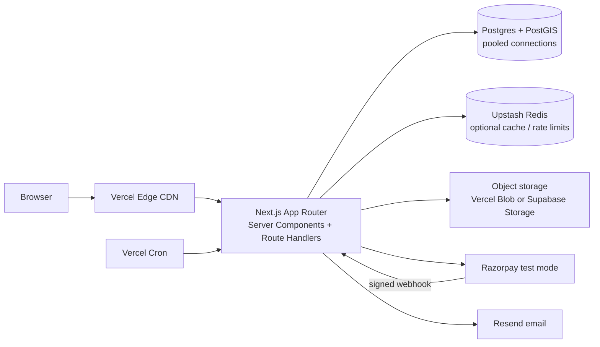

# Toghar architecture

## Booking data flow

1. The guest searches server-rendered hostel and college data. College suggestions can be cached; distance queries use PostGIS geography points.
2. The guest selects a room/bed and date range. A route handler validates inputs, then starts a Postgres transaction. Production must verify the authenticated guest role before this route is exposed.
3. The transaction locks the selected bed row with `SELECT ... FOR UPDATE`, checks for overlapping held/confirmed/checked-in bookings, and inserts a `held` booking with a ten-minute expiry. The lock serializes competing claims on the same bed; the second request sees the first hold and receives a conflict.
4. The payment provider receives the server-calculated amount. A signed webhook is verified and recorded by unique provider event ID before changing the booking to confirmed, making retries idempotent.
5. Vercel Cron calls the hold-expiry route daily (compatible with Vercel Hobby); expired holds are immediately ignored by availability checks and marked cancelled by scheduled cleanup. Confirmation/cancellation email work can run from a short route-handler task; a queue can replace it later.

## Launch scale

Vercel serves static assets and cached pages from its CDN and autos-scales serverless route handlers. Use a managed Postgres pooler for serverless connection churn, indexes on `(bedId,startDate,endDate,status)` and the PostGIS geography column for booking and distance queries, and cache hot college/area lookups in Redis with an in-memory local fallback. Store listing images in object storage and serve optimized derivatives through the image CDN. Keep serverless requests short and make payment/webhook operations idempotent.

## Growth path

Add read replicas for browse traffic, move complex full-text/faceted search to a dedicated search service, and put email/notification delivery on a durable queue. Move CPU-heavy recommendations, bulk imports, and long-running media processing to dedicated workers outside serverless. Keep booking writes on the primary database and preserve the per-bed transactional exclusion/locking guarantee.
